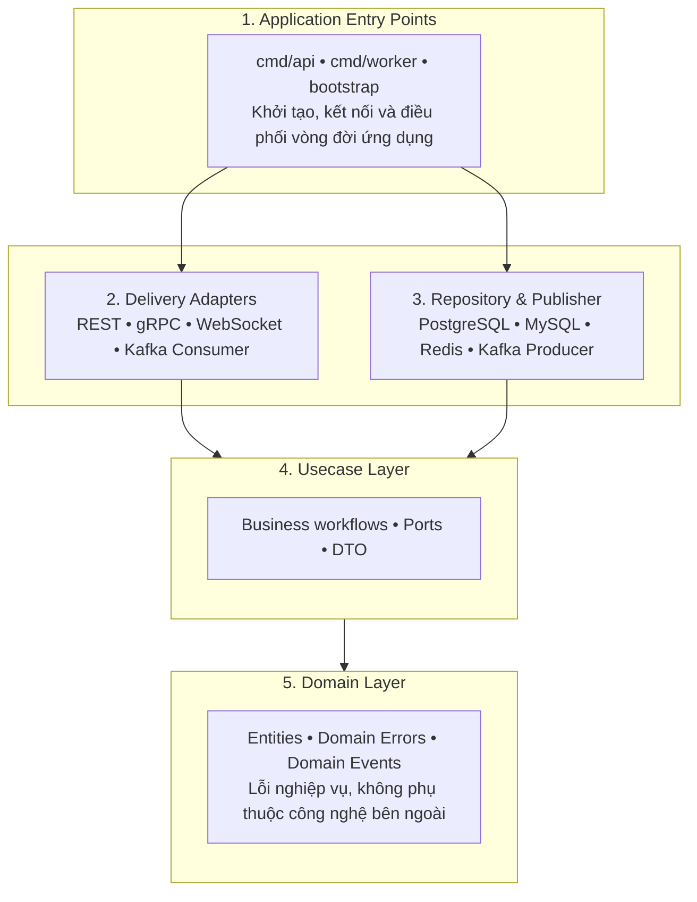

## I. Tổng quan kiến trúc

Cấu trúc dự án áp dụng Clean Architecture kết hợp Ports & Adapters (Hexagonal Architecture).



Các mũi tên trong sơ đồ biểu diễn **chiều phụ thuộc của mã nguồn** (package nào import package nào), không phải chiều gọi hàm lúc chạy. Quy tắc cốt lõi: phụ thuộc chỉ hướng vào trong, từ adapter đến usecase rồi đến domain.

> Ở runtime, usecase vẫn gọi repository, nhưng về mặt mã nguồn thì repository adapter lại phụ thuộc vào interface do usecase khai báo (Dependency Inversion). Nếu không phân biệt hai chiều này, mũi tên `RP --> UL` trong sơ đồ sẽ trông như mâu thuẫn với luồng gọi thực tế.

## Tổng quan các nhóm thư mục

| Thư mục | Vai trò chính |
| :--- | :--- |
| `cmd/` | Điểm khởi chạy ứng dụng |
| `internal/domain/` | Định nghĩa đối tượng và quy tắc nghiệp vụ cốt lõi |
| `internal/usecase/` | Điều phối các nghiệp vụ của ứng dụng |
| `internal/adapter/` | Kết nối nghiệp vụ với bên ngoài (inbound: delivery; outbound: repository, publisher) |
| `internal/infrastructure/` | Khởi tạo, cấu hình và quản lý tài nguyên kỹ thuật |
| `internal/bootstrap/` | Ghép nối các dependency để tạo ứng dụng hoàn chỉnh |
| `api/` | Định nghĩa hợp đồng API công khai |
| `gen/` | Chứa mã nguồn sinh tự động |
| `db/` | Chứa SQL queries và migrations |
| `configs/` | Cấu hình ứng dụng và cấu hình công cụ sinh mã |
| `pkg/` | Các package tổng quát, độc lập với nghiệp vụ, có thể tái sử dụng |
| `test/` | Integration test và công cụ hỗ trợ test |
| `deployments/` | Cấu hình hạ tầng và triển khai |
| `.github/` | CI/CD bằng GitHub Actions |


---

## Đặc tả chi tiết từng phần trong cấu trúc của Project

## `cmd/` — Điểm khởi chạy

```
cmd/
├── api/
│   ├── main.go
│   └── wire/
│       ├── wire.go
│       └── wire_gen.go
└── worker/
    ├── main.go
    └── wire/
        ├── wire.go
        └── wire_gen.go
```

Thư mục `cmd/` chứa các chương trình có thể biên dịch và chạy độc lập. Mỗi thư mục con tương ứng với một binary.

`cmd/api/`
- Đại diện cho ứng dụng phục vụ request từ client.
- Là entry point: khởi tạo application, lắng nghe tín hiệu hệ điều hành (SIGINT, SIGTERM) và thực hiện graceful shutdown, tức là ngừng nhận request mới và chờ các request đang xử lý hoàn tất trước khi thoát.
- `wire/wire.go` định nghĩa injector của Google Wire, chọn provider set cần dùng cho ứng dụng. `wire_gen.go` là file do Wire sinh ra, không chỉnh sửa thủ công.

Ví dụ, API process có thể chạy REST, gRPC và WebSocket đồng thời.

`cmd/worker/`
- Đại diện cho background worker độc lập với API process.
- Khởi động worker và quản lý vòng đời của consumer, bao gồm cả graceful shutdown (dừng nhận message mới, hoàn tất message đang xử lý, commit offset rồi mới thoát).

**Tại sao cần tách api và worker?**

API và Kafka consumer có đặc điểm tải khác nhau. API chịu tải theo lưu lượng request của client, còn worker chịu tải theo tốc độ message đổ vào topic. Việc tách binary cho phép scale độc lập, ví dụ chạy 3 API instances nhưng chỉ 2 worker instances, mà không cần thay đổi business logic. Lưu ý rằng số consumer xử lý song song trong cùng một consumer group bị giới hạn bởi số partition của topic: các instance vượt quá số partition sẽ ở trạng thái nhàn rỗi.

**Lưu ý kỹ thuật về package Wire:** Các file Wire trong `cmd/api/wire/` nên dùng package riêng (ví dụ `wire`) thay vì `package main`. Khi đó `main.go` gọi hàm khởi tạo được export từ package này (ví dụ `wire.InitializeApp`). Cách tổ chức này hợp lệ. Hai điểm cần nhớ:
- File `wire.go` phải có build tag `//go:build wireinject` để không bị biên dịch vào binary; chỉ `wire_gen.go` được biên dịch.
- Hàm injector phải viết hoa chữ cái đầu để `main.go` ở package khác gọi được.

---

## `internal/` — Application Core

Đây là thư mục quan trọng nhất. Trong Go, mọi package nằm dưới `internal/` chỉ có thể được import bởi mã nằm trong cùng module gốc, nên toàn bộ lõi ứng dụng được bảo vệ khỏi việc bị project khác import.

```
internal/
├── adapter/
├── bootstrap/
├── domain/
├── infrastructure/
└── usecase/
```

Các phần dưới đây được phân tích từ lõi nghiệp vụ ra ngoài.

### `internal/domain/` — Enterprise Business Rules

Domain chứa các quy tắc nghiệp vụ cốt lõi: entity, domain error và domain event. Domain không quan tâm dữ liệu đến từ REST, gRPC hay Kafka, cũng không quan tâm dữ liệu được lưu trong PostgreSQL hay MySQL.

Nguyên tắc: Domain không được import gin, pgx, redis, kafka-go, grpc hoặc các package thuộc layer bên ngoài. Chỉ dùng standard library khi cần.

Ví dụ minh họa cho domain User:

```
internal/domain/user/
├── entity.go      // struct User và các phương thức bảo vệ bất biến (invariant)
├── errors.go      // ErrUserNotFound, ErrEmailAlreadyExists, ...
└── events.go      // UserCreated, UserUpdated, ...
```

### `internal/usecase/` — Application Business Rules

Usecase định nghĩa ứng dụng thực hiện nghiệp vụ như thế nào bằng cách phối hợp domain và các interface (port). Usecase cũng không được import các thư viện hạ tầng hay các kiểu sinh ra từ Protobuf, nhằm giữ độc lập với REST/gRPC.

| File | Trách nhiệm |
| :--- | :--- |
| `create.go` | Quy trình tạo User: kiểm tra điều kiện, lưu User và phát sự kiện qua `EventPublisher` |
| `get.go` | Quy trình lấy User theo ID |
| `list.go` | Quy trình lấy danh sách User, phân trang và lọc |
| `update.go` | Quy trình cập nhật User |
| `delete.go` | Quy trình xóa User |
| `dto.go` | Input/output DTO dành cho usecase, độc lập với HTTP/gRPC |
| `ports.go` | Khai báo các interface mà usecase cần |
| `service.go` | Khởi tạo service, chứa dependency và triển khai các usecase method |

**Tại sao ports.go quan trọng?**

Đây là nơi áp dụng Dependency Inversion Principle (DIP). Ví dụ `CreateUser` cần lưu User, nhưng không cần biết đang dùng PostgreSQL hay MySQL. Vì vậy usecase chỉ phụ thuộc `UserRepository` interface. Các implementation PostgreSQL/MySQL implement interface đó ở adapter layer. Tương tự, usecase cần phát sự kiện thì phụ thuộc `EventPublisher` interface thay vì gọi trực tiếp Kafka.

Nhờ đó, khi thay Kafka bằng RabbitMQ, usecase không cần sửa; chỉ cần viết adapter mới và thay đổi provider ở bootstrap.

Việc interface được khai báo ở phía **bên dùng** (usecase) thay vì phía bên cài đặt (adapter) cũng là thông lệ của Go: interface nhỏ, đặt gần nơi sử dụng, chỉ chứa những phương thức mà usecase thực sự cần.

### `internal/adapter/` — Adapters Layer

Theo thuật ngữ Hexagonal Architecture, adapter chia thành hai nhóm:
- **Inbound (driving) adapter**: nhận yêu cầu từ bên ngoài và gọi vào usecase. Gồm `delivery/rest`, `delivery/grpc`, `delivery/websocket`, `delivery/consumer`.
- **Outbound (driven) adapter**: được usecase gọi ra thông qua port để làm việc với hệ thống bên ngoài. Gồm `repository/persistence` và các publisher.

`adapter/delivery/rest/`: Đây là tầng tiếp nhận HTTP requests từ client. Handler chuyển đổi request thành DTO của usecase, gọi usecase, rồi chuyển kết quả hoặc lỗi thành HTTP response.

Ví dụ:
```
POST /api/v1/users
        |
        v
UserHandler.Create()
        |
        v
UserUsecase.Create()
        |
        v
UserRepository.Create()
```

`adapter/delivery/grpc/`: Đây là adapter nhận gRPC requests. REST và gRPC sử dụng chung một User usecase, không triển khai lại nghiệp vụ. Việc chuyển đổi giữa message Protobuf (trong `gen/proto/`) và DTO của usecase được thực hiện tại adapter này.

`adapter/delivery/websocket/`: Đây là tầng phục vụ realtime communication.

| File | Trách nhiệm |
| :--- | :--- |
| `client.go` | Quản lý một WebSocket connection, đọc/ghi message và đóng kết nối |
| `hub.go` | Quản lý các client connections và phân phối message |
| `user_handler.go` | Upgrade HTTP connection, xử lý message liên quan đến User |

Ví dụ, khi User được tạo thành công, hệ thống có thể phát thông báo `user.created` đến các client đang kết nối. WebSocket hub chỉ nên chịu trách nhiệm vận chuyển message. Nó không được tự truy vấn database hoặc tự quyết định business rules. Usecase cũng không được import trực tiếp package websocket; thông báo đến hub thông qua một port (ví dụ `EventPublisher`) hoặc một event bus nội bộ.


`adapter/delivery/consumer/`: Đây là Kafka inbound adapter. Nhiệm vụ:
- Nhận message từ Kafka topic.
- Giải mã (deserialize) payload.
- Kiểm tra message hợp lệ.
- Gọi usecase tương ứng.
- Quản lý retry và commit offset theo chính sách xử lý.

Hai lưu ý quan trọng:
1. Kafka consumer không nhất thiết phải gọi lại `CreateUser` khi nhận sự kiện `UserCreated`, vì điều đó có thể tạo User trùng lặp. Consumer nên xử lý một workflow phù hợp, ví dụ cập nhật read model hoặc xử lý một command từ hệ thống khác.
2. Kafka đảm bảo giao message theo cơ chế at-least-once, nghĩa là cùng một message có thể được giao nhiều lần (sau retry hoặc rebalance). Usecase mà consumer gọi vào phải **idempotent**, và chỉ commit offset sau khi xử lý thành công. Message liên tục lỗi nên được chuyển sang dead-letter topic thay vì chặn toàn bộ partition.

`adapter/repository/persistence/`: Đây là các outbound adapter triển khai persistence. Adapter này sử dụng code do sqlc sinh ra trong `gen/sqlc/`, đồng thời chịu trách nhiệm ánh xạ giữa model của sqlc và entity của domain, để các kiểu sinh tự động không rò rỉ vào usecase hay domain.

Luồng minh họa với cache:

```
User Usecase
     |
     v
UserRepository (interface, khai báo tại usecase/ports.go)
     ^
     |  implements
CachedUserRepository  (decorator)
     |
     +------> Redis Cache
     |
     +------> PostgreSQL/MySQL Repository
```

`CachedUserRepository` là một decorator: nó implement cùng interface `UserRepository`, kiểm tra cache trước, nếu không có thì ủy quyền cho repository thật và ghi kết quả vào cache. Điều này giúp bật/tắt cache trong DI configuration mà không phải sửa User usecase. Lưu ý rằng các thao tác ghi (update, delete) phải vô hiệu hóa (invalidate) cache tương ứng để tránh trả về dữ liệu cũ.

**Publisher (Kafka producer):** Sơ đồ tổng quan có nhắc Kafka Producer ở nhóm outbound adapter, nhưng cấu trúc thư mục không có chỗ cho thành phần này. Cần có một thư mục riêng, ví dụ `adapter/publisher/kafka/`, chứa implementation của `EventPublisher`.


### `internal/infrastructure/` — Infrastructure

```
infrastructure/
├── cache/
│   └── redis.go
├── config/
│   ├── config.go
│   └── loader.go
├── database/
│   ├── mysql.go
│   └── postgres.go
├── logger/
│   └── slog.go
├── messaging/
│   └── kafka.go
└── server/
    └── http.go
```

Infrastructure chịu trách nhiệm khởi tạo và quản lý vòng đời các tài nguyên kỹ thuật (connection pool, client, server, logger, cấu hình). Adapter chịu trách nhiệm sử dụng những tài nguyên đó để thực hiện một port. Ví dụ, `database/postgres.go` tạo `pgxpool.Pool`; `adapter/repository/persistence` nhận pool này qua constructor và dùng nó để hiện thực `UserRepository`.

### `internal/bootstrap/` — Dependency Assembly

Bootstrap là composition root: nơi ghép các thành phần thành một ứng dụng hoàn chỉnh.
- `providers.go`: Khai báo các provider function hoặc Wire provider set.
- `api.go`: Tổ chức dependency và lifecycle của API application.
- `worker.go`: Tổ chức dependency và lifecycle của worker application.

Quan hệ với `cmd/*/wire/`: `bootstrap/providers.go` chứa các provider set dùng chung, còn `cmd/api/wire/wire.go` và `cmd/worker/wire/wire.go` chọn tập provider cần thiết cho từng binary, sau đó Wire sinh mã khởi tạo.

Ví dụ, tại bootstrap quyết định sử dụng chuỗi triển khai sau:

```
UserRepository (interface)
        ^
        |  được implement bởi
CachedUserRepository
        |
        |  ủy quyền cho
PostgreSQLUserRepository   (đồng thời dùng Redis client cho cache)
        |
        |  sử dụng
pgxpool.Pool
```

Nếu muốn đổi PostgreSQL sang MySQL, thay implementation được cung cấp tại composition root. Điều kiện đi kèm là adapter MySQL tương ứng đã tồn tại, cùng với query của sqlc và migration cho MySQL.

Bootstrap được phép import cả usecase, adapter và infrastructure. Đây là vai trò có chủ đích của composition root, không phải vi phạm Clean Architecture. Ngược lại, không layer nào khác được import `bootstrap`.

---

## `api/` và `gen/` — API Contracts & Generated Code

```
api/
└── proto/

gen/
├── proto/
│   └── user/
│       └── v1/
│           ├── user.grpc.pb.go
│           └── user.pb.go
└── sqlc/
    ├── mysql/
    └── postgres/
```

- `api/proto/` chứa file `.proto` định nghĩa hợp đồng gRPC, là nguồn sự thật duy nhất (single source of truth) cho API.
- `gen/proto/` chứa mã Go sinh ra từ file `.proto` (dùng `buf generate`, cấu hình tại `configs/buf.gen.yaml`).
- `gen/sqlc/` chứa mã Go sinh ra từ SQL queries trong `db/queries/`, tách riêng theo từng database engine.

Quy tắc: Không chỉnh sửa thủ công file trong `gen/`. Khi SQL hoặc Protobuf thay đổi, chạy lại generator. Nên quy định rõ trong dự án việc có commit thư mục `gen/` vào repository hay sinh lại trong CI, và áp dụng nhất quán.

---

## `db/` — Database Schema & Queries

```
db/
├── migrations/
│   └── postgres/
└── queries/
    ├── mysql/
    └── postgres/
```

`db/migrations/`
Chứa các phiên bản thay đổi database schema. Ví dụ, migration đầu tiên tạo bảng `users`; migration tiếp theo thêm một cột hoặc index. Mỗi migration nên có cặp file `.up.sql` và `.down.sql` khi có thể rollback an toàn. Hiện tại mới có `migrations/postgres/`. Nếu MySQL là database được hỗ trợ chính thức, cần bổ sung `migrations/mysql/`.

`db/queries/`
Chứa SQL queries được sqlc sử dụng để generate code. Do cú pháp PostgreSQL và MySQL có khác biệt, việc tách query files theo engine là hợp lý.

---

## `configs/` — Application Configuration

```
configs/
├── buf.gen.yaml
└── local.yaml
```

- `buf.gen.yaml`: Cấu hình cho `buf generate`, khai báo các plugin sinh mã Protobuf và thư mục đầu ra (`gen/proto/`).
- `local.yaml`: Cấu hình ứng dụng cho môi trường local, được đọc bởi `internal/infrastructure/config/`.

Không đặt thông tin bí mật (mật khẩu, token, khóa API) trong các file cấu hình được commit. Giá trị nhạy cảm nên lấy từ biến môi trường hoặc secret manager, và ghi đè lên giá trị trong file khi nạp cấu hình.

---

## `deployments/` — Deployment

```
deployments/
└── docker/
    └── docker-compose.yml
```

`docker-compose.yml` khởi tạo các dịch vụ cần thiết cho môi trường local:
- PostgreSQL.
- MySQL.
- Redis.
- Kafka ở chế độ KRaft (không cần ZooKeeper).
- Có thể bổ sung API và worker containers.

Dockerfile ở root định nghĩa cách build Go application thành container image. Vì dự án có hai binary (`cmd/api` và `cmd/worker`), nên dùng multi-stage build với tham số chọn binary cần build (build argument hoặc build target), thay vì viết hai Dockerfile trùng lặp.

---

## `pkg/` — Reusable Packages

Thư mục này dành cho các package được thiết kế để project khác có thể import và sử dụng. Ví dụ về sau có thể có thư viện xử lý pagination hoặc utility độc lập với nghiệp vụ.

Nguyên tắc: package trong `pkg/` không được import bất cứ thứ gì từ `internal/`, nếu không sẽ phụ thuộc ngược vào lõi ứng dụng. Nếu một package chỉ phục vụ riêng dự án này và không có ý định chia sẻ, nên đặt trong `internal/` để tránh vô tình mở rộng bề mặt API công khai.

---

## `test/` — Testing

```
test/
├── integration/
│   └── user_repository_test.go
└── testutil/
    └── container.go
```

`test/integration/`
Chứa integration tests, kiểm tra việc phối hợp giữa application và tài nguyên thật. Ví dụ: dùng Testcontainers tạo PostgreSQL container, chạy migrations, sau đó kiểm tra User repository có lưu và đọc dữ liệu chính xác không. Do cần Docker và chạy chậm hơn unit test, nên gắn build tag (ví dụ `//go:build integration`) để tách khỏi lệnh `go test ./...` thông thường.

`test/testutil/`
Chứa các helper dùng chung cho test như tạo container, chạy migration, tạo dữ liệu mẫu và cleanup.

---

## Đề xuất mở rộng

Các mục sau không được áp dụng trực tiếp vào nội dung ở trên vì chúng là lựa chọn thiết kế, cần cân nhắc theo bối cảnh dự án. Mỗi mục nêu đánh đổi để nhóm tự quyết định.

### 1. Quản lý transaction trong usecase

Hiện tại tài liệu chưa nói cách usecase thực hiện nhiều thao tác lưu trữ trong cùng một transaction (ví dụ tạo User và ghi một bản ghi liên quan).

| Phương án | Ưu điểm | Nhược điểm |
| :--- | :--- | :--- |
| Port `TxManager` (hoặc Unit of Work) trong `ports.go`, nhận hàm callback chạy trong transaction | Usecase kiểm soát ranh giới transaction mà không biết đến công nghệ DB; dễ test | Thêm một lớp trừu tượng; repository phải lấy transaction từ context, cần quy ước rõ |
| Đặt logic nhiều bước trong một phương thức của repository | Đơn giản, ít trừu tượng | Nghiệp vụ lọt vào adapter, vi phạm ranh giới layer; khó tái sử dụng |

### 2. Đảm bảo phát sự kiện không bị mất (Transactional Outbox)

Luồng "lưu User vào DB rồi phát `UserCreated` lên Kafka" có thể thất bại giữa hai bước (DB đã lưu nhưng Kafka lỗi), dẫn đến mất sự kiện.

| Phương án | Ưu điểm | Nhược điểm |
| :--- | :--- | :--- |
| Phát trực tiếp sau khi commit (hiện trạng) | Đơn giản, độ trễ thấp | Có thể mất sự kiện nếu tiến trình chết hoặc Kafka lỗi sau commit |
| Transactional Outbox: ghi sự kiện vào bảng outbox cùng transaction, worker riêng đọc bảng và phát lên Kafka | Không mất sự kiện, nhất quán với dữ liệu | Thêm bảng, thêm worker; sự kiện có thể bị phát trùng nên consumer phải idempotent; độ trễ cao hơn |

### 3. Công cụ dependency injection

Google Wire sinh mã tại thời điểm biên dịch nên lỗi cấu hình dependency được phát hiện sớm. Cần kiểm tra tình trạng bảo trì hiện tại của dự án này trước khi chọn làm nền tảng dài hạn.

| Phương án | Ưu điểm | Nhược điểm |
| :--- | :--- | :--- |
| Google Wire | Kiểm tra lúc biên dịch, không có chi phí lúc chạy, mã sinh ra dễ đọc | Cần bước sinh mã; phụ thuộc vào việc dự án còn được duy trì |
| Uber fx | Quản lý vòng đời (start/stop hook) sẵn có, hệ sinh thái module | Dùng reflection nên lỗi chỉ lộ ra lúc chạy; đường cong học tập cao hơn |
| DI thủ công trong `bootstrap/` | Không phụ thuộc thư viện, dễ hiểu nhất với người mới | Mã khởi tạo dài và phải sửa tay khi đồ thị dependency lớn dần |

### 4. Cách tổ chức thư mục theo layer hay theo feature

Cấu trúc hiện tại nhóm theo layer kỹ thuật (domain, usecase, adapter). Khi số lượng entity tăng, mỗi layer sẽ chứa nhiều thư mục con tương ứng từng entity.

| Phương án | Ưu điểm | Nhược điểm |
| :--- | :--- | :--- |
| Giữ nhóm theo layer (hiện trạng) | Ranh giới layer rõ ràng, dễ kiểm tra quy tắc phụ thuộc | Một tính năng bị phân tán qua nhiều thư mục |
| Nhóm theo feature, mỗi feature chứa các layer bên trong (`internal/user/{domain,usecase,adapter}`) | Mã của một tính năng nằm cạnh nhau, dễ tách thành service riêng | Khó kiểm soát phụ thuộc chéo giữa các feature; cần kỷ luật cao hơn |

### 5. Công cụ kiểm tra quy tắc phụ thuộc tự động

Các quy tắc như "domain không được import gin/pgx" hiện chỉ dựa vào kỷ luật của lập trình viên. Có thể tự động hóa trong CI bằng linter (ví dụ `depguard` trong golangci-lint, hoặc `go-arch-lint`) để vi phạm bị phát hiện ngay ở pull request. Đánh đổi là phải duy trì thêm tệp cấu hình quy tắc song song với cấu trúc thư mục.